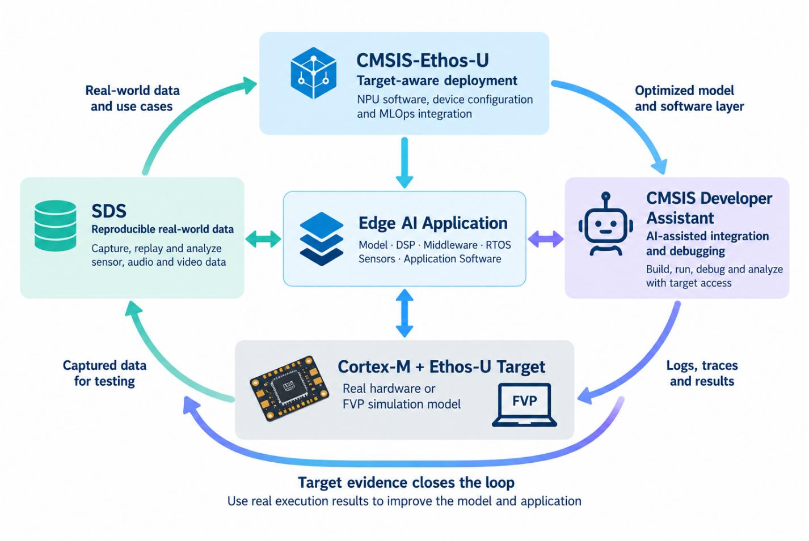
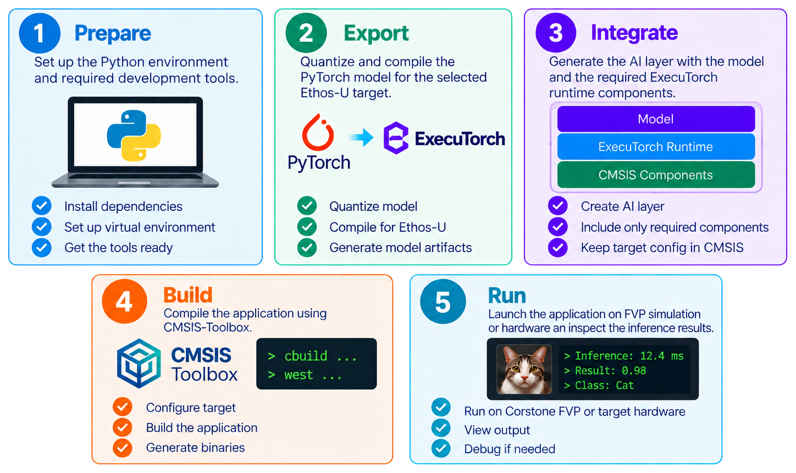
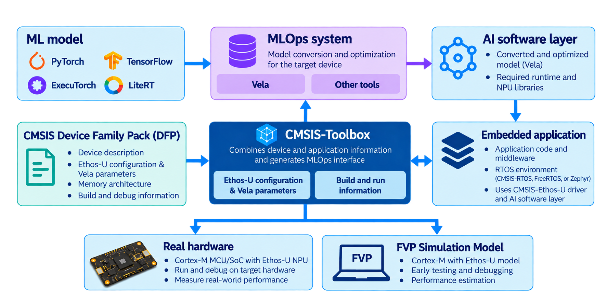
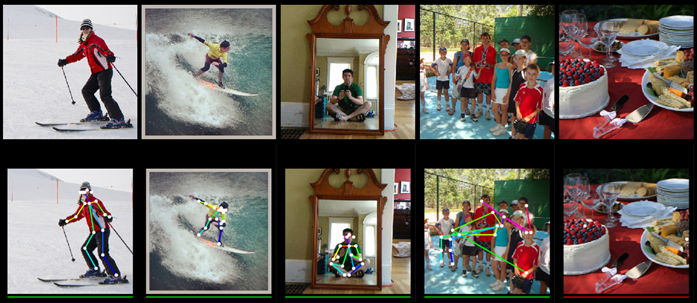
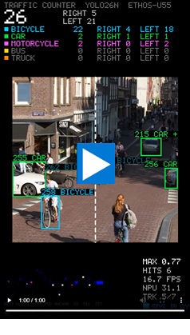

[**Arm Examples**](https://github.com/Arm-Examples/) &raquo; **ExecuTorch on real devices**

# Create ExecuTorch applications for real devices

An Edge AI application is more than an ML model. The ML model must fit the target's
memory architecture, use its Ethos-U configuration, connect to application and
sensor code, and run reliably on the real device. This tutorial shows how to
turn the CMSIS-Executorch template into such an application with an AI coding
agent: adapt an ML model developed in PyTorch to the selected Cortex-M and
Ethos-U target, validate it with repeatable SDS tests on an FVP simulation
model, and use the CMSIS Developer Assistant to deploy, measure, and debug the
same application on real hardware.

This tutorial puts the workflow introduced in
[Making Edge AI Development More Productive](https://developer.arm.com/community/arm-community-blogs/b/tools-software-ides-blog/posts/making-edge-ai-development-more-productive)
into practice. The [CMSIS Developer Assistant](https://marketplace.visualstudio.com/items?itemName=Arm.cmsis-developer-assistant) helps the agent use the project,
simulation, and hardware tools throughout the workflow. The agent plans the
work and asks you only for information it cannot obtain from the project, such
as which board is attached or when it has been power-cycled.



The application sits at the center of a continuous development loop.
[CMSIS-Ethos-U](https://arm-software.github.io/CMSIS-Ethos-U/) combines the NPU
software with device configuration and MLOps information to generate an
optimized ML model and AI software layer for the selected target. The
[CMSIS Developer Assistant](https://marketplace.visualstudio.com/items?itemName=Arm.cmsis-developer-assistant)
helps integrate, build, run, and debug the complete application, while the
[SDS Framework](https://github.com/ARM-software/SDS-Framework) captures and
replays representative sensor, audio, or video data.

Execution on the Cortex-M and Ethos-U target produces logs, traces, inference
outputs, performance measurements, and recorded data. This target evidence
flows back into the next iteration: it reveals integration problems, supplies
repeatable tests, and guides changes to the ML model and application. An FVP
starts this loop before hardware is available; the real board later validates
the same software with its actual peripherals, memory system, timing, and data.

## Edge AI application template

The [CMSIS-Executorch template](https://github.com/Arm-Examples/CMSIS-Executorch)
provides a working starting point for this integration. It connects a PyTorch
ML model to the ExecuTorch runtime, the Arm Ethos-U backend, CMSIS-Toolbox, and
the [CMSIS-Ethos-U pack](https://www.keil.arm.com/packs/cmsis-ethos-u-arm/overview/).
The template includes Corstone reference targets, but its workflow applies to
all Ethos-U configurations. It provides a repeatable path from model export and
integration to execution on an FVP or real hardware.



The [CMSIS Developer Assistant](https://marketplace.visualstudio.com/items?itemName=Arm.cmsis-developer-assistant)
helps adapt that starting point to real hardware. It gives an AI coding agent
access to CMSIS project information, software-pack documentation, the build
system, the build artefacts (ELF, linker map, build log), and the CMSIS
Debugger. The agent can therefore select the correct device support, create a
board layer, configure a debug probe, build and program the application, halt
the processor and read its registers and memory, and inject test inputs into a
running target.

## How it works together



[CMSIS-Toolbox](https://open-cmsis-pack.github.io/cmsis-toolbox/) resolves the target description and application ML configuration
into a generated `*.cbuild-mlops.yml` file:

- The device family pack describes the processor, memory, and device-specific
  Ethos-U and Vela configuration.
- The `*.csolution.yml` project file adds the application, ML model, build, and run information.
- CMSIS-Toolbox resolves this information for the selected target and writes
  the MLOps (`*.cbuild-mlops.yml`) description.
- `create_ai_layer.py` uses this `*.cbuild-mlops.yml` description to quantize and export the ML
  model, delegate supported operators to Ethos-U, and generate the
  target-specific AI software layer.
- CMSIS-Toolbox builds the AI layer together with the embedded application.

This preserves the hardware-specific information needed for optimization while
keeping the deployment steps consistent across devices. The agent runs these
steps for you; the [command-line equivalents](#behind-the-prompts-the-three-step-flow)
are listed at the end for reference.

As the diagram shows, the project description connects the generated AI layer
and application with the selected FVP or hardware target.

## What you need

- A development board or custom device with an Arm Cortex-M processor and an
  Ethos-U55, Ethos-U65, or Ethos-U85 NPU. The board can arrive later: the
  application can first run on an FVP.
- A CMSIS device family pack for the device and either an existing board support
  layer or enough board information to create one.
- A CMSIS-DAP, ST-Link, ULINKplus, or J-Link debug connection supported by the
  [CMSIS Debugger](https://marketplace.visualstudio.com/items?itemName=Arm.vscode-arm-debugger).
- [Keil Studio for VS Code](https://marketplace.visualstudio.com/items?itemName=Arm.keil-studio-pack),
  the VS Code Python extension, and the CMSIS Developer Assistant.
- An MCP-compatible AI coding agent configured by the Developer Assistant.
- An ML model implemented in PyTorch and representative calibration inputs, or
  an application goal that lets the agent propose one.

> [!TIP]
> Before starting this tutorial, create and run a simple Blinky project for
> your board in Keil Studio. This introduces the end-to-end workflow and
> verifies the tool setup before adding the ML application. Alif board setup
> can require additional care because it uses SETOOLS; see the
> [Alif Ensemble pack overview](https://www.keil.arm.com/packs/ensemble-alifsemiconductor/overview/)
> for the required tools and setup information.

Install the [CMSIS Developer Assistant from the VS Code Marketplace](https://marketplace.visualstudio.com/items?itemName=Arm.cmsis-developer-assistant),
then reload VS Code.

> [!IMPORTANT]
> The rest of this document is a step-by-step tutorial with generic example
> prompts. Before sending a prompt to the agent, replace every term in angle
> brackets (`<...>`) with information for your application and target. For
> example, replace `<application>` with `a person-detection application` and
> adapt the Alif Ensemble E7 AppKit details to your own board and revision.
> Adapt or remove optional details, such as sensors and displays, when they do
> not apply. Do not send the placeholders literally.
>
> - [What a run looks like](#what-a-run-looks-like-pose-estimation-on-the-alif-ensemble-e7-appkit)
>   includes the prompts used for a pose-estimation example.
> - The [CMSIS ExecuTorch traffic counter](https://github.com/Arm-Examples/CMSIS-Executorch-Traffic-Counter)
>   is a complete application created with this workflow.

## Set up the project

### Create a repository from the template

Open [CMSIS-Executorch](https://github.com/Arm-Examples/CMSIS-Executorch) and
select **Use this template**. Clone the new repository and open its folder in
VS Code.

Choose the solution that matches the NPU family you intend to target:

- For Ethos-U85, select `cmsis-executorch.csolution.yml`.
- For Ethos-U55 or Ethos-U65, select
  `cmsis-executorch-u55.csolution.yml` as the starting point.

In the VS Code CMSIS view, select **... > Select Active Solution from
Workspace**, then choose the solution above. Load the project this way before
continuing: the CMSIS Solution extension creates the workspace tasks used to
set up the Python environment and generate the AI layer.

With the solution loaded, follow the template README section
[Set up the project tools](https://github.com/Arm-Examples/CMSIS-Executorch#2-set-up-the-project-tools).
It covers tool installation and the generated task that creates the Python
environment used to export the ML model for ExecuTorch.

Build and run the supplied reference configuration once before changing
anything. This separates template or tool-installation issues from your own
port.

### Connect the CMSIS Developer Assistant

Run **CMSIS Developer Assistant: Configure Agent** from the VS Code Command
Palette. Select your AI agent; the extension registers its MCP server with the
agent and installs the CMSIS skills (live debugging, board layer, pack
documentation, help) in the agent's personal skills folder, so they are
available in every workspace.

Check that the agent can see the project before asking it to make changes:

```text
Inspect this CMSIS-Executorch workspace. Identify the loaded solution, active
target, required packs, compiler, and available debug adapters. Do not modify
the project yet.
```

The answer should describe the Corstone target and confirm access to the
CMSIS solution tools. If more than one VS Code window is open, tell the agent
which workspace to use.

## Run the application on the simulator

Give the agent the application goal and the hardware, and say that the board
is not attached yet. Ask for a self-test so that the result is visible without
a camera, microphone, or sensor:

```text
Starting from CMSIS-Executorch, create <application> for the Alif Ensemble E7
AppKit, using its <camera, microphone, or sensor> and <display>. The board is not
attached yet: do all tests on the FVP. Justify the ML model you select and its
license. Build a self-test into the application that runs a fixed input at
start-up and compares the result with the host-side PyTorch reference.
```

What the agent does:

- finds a candidate ML model, checks its license, and adapts it to the target:
  removes outputs the application does not use, folds preprocessing into the
  graph, and trims it until the exported program fits the device's memory;
- quantizes and exports it for the Ethos-U configuration of the device and
  reports how many operators run on the NPU and how many fall back to the CPU;
- adds the device and board to the solution as a new target type, using the
  pack documentation to resolve the exact device, DFP, BSP, and Ethos-U
  configuration, and creates a board layer when no packaged one fits;
- writes the application: input acquisition, inference, output
  interpretation, and the self-test;
- builds for an FVP with the same Ethos-U configuration and runs it.

**Result:** the FVP console shows the Ethos-U version, the program size,
the input and output shapes, and the self-test result (`Test_result: PASS`).
Ask for the memory table: the ML model, the method and temp pools, and the
frame or sample buffers, each with the region it lives in. Do not accept a
Corstone memory map for a hardware target; the linker regions and Vela memory
mode must describe the real device.

If the quantized ML model agrees poorly with the float reference, this is the
point to fix it, before any board work. The ML model is one component of the
application; a research model often needs changes before it quantizes
well.

> [!NOTE]
> FVPs model the NPU cycle by cycle and are slow: a 2 GMAC inference takes
> about half a second of simulated time and about 40 seconds of wall-clock
> time. Keep FVP test sets to a few inputs; the full data set runs on the
> board later.

## Run the same application on the board

Connect and power the board, set its console switch, and tell the agent:

```text
The Alif Ensemble E7 AppKit is connected via <connector>, with
<switch or jumper setting>.
Configure Load & Debug for its <CMSIS-DAP, ST-Link, ULINKplus, or J-Link>
probe, program the image, stop at main, run the self-test, and compare the
result and the inference time with the FVP run.
```

What the agent does:

- lets the CMSIS Solution extension generate the debugger configuration from
  the target, so that the manual and agent-driven workflows stay aligned;
- builds, programs, and stops at `main` through the Developer Assistant's
  build, load, and debug actions, the same ones the CMSIS view runs;
- reads the console, and when a reading is unclear, halts the processor and
  inspects registers, memory, and peripherals instead of guessing;
- asks you for the physical steps it cannot perform: a boot-table or
  debug-stub installation through the vendor's tools, a console switch, a
  replug when the board drops off USB, a power cycle. Short answers are enough.

**Result:** the self-test on the board gives the same keypoints, classes,
or scores as the FVP, bit for bit. Both run the same NPU command stream, so a
difference points at memory placement, cache maintenance, or interrupt
routing, not at the ML model. The console shows the inference time; expect it
to be far shorter than the FVP's simulated time.

Prove the board with the self-test before connecting live sensors. Startup,
programming, breakpoints, and console output are much easier to diagnose
without a camera pipeline running.

## Create repeatable tests with SDS

Edge AI applications interact with a physical world that changes continuously.
Recreating the exact input that exposed a failure may be as hard as finding
the problem itself. The [Synchronous Data Stream Framework](https://github.com/ARM-software/SDS-Framework)
turns real-world conditions into reusable engineering data: it captures input
and output streams and replays the same inputs on an FVP or real hardware. A
one-off failure becomes a repeatable test case.

```text
Add an SDS test harness. Use <InputStream> as the playback stream and record
<ModelOut> and <Result>. Keep the normal sensor path selectable. Create
playback files from <these images or recordings>, run them on the <FVP or
board>, compare every result with the host-side PyTorch reference using
<tolerance>, and save the logs, raw SDS output, a summary, and a rendered
image for every test case. Stop cleanly at end-of-stream so the test can run
unattended in CI.
```

Decide the streams before the agent writes target code; one stream per
boundary a test must control or observe. A vision application might use:

| Stream | Direction | Contents |
|---|---|---|
| `CameraIn` | Playback to the application | Preprocessed camera frame presented to the ML model |
| `ModelOut` | Record from the application | Raw logits, heatmaps, boxes, or keypoints |
| `Result` | Record from the application | Post-processed result used by the product |

Keep raw ML model output and post-processed application output separate. This
lets you tell whether a regression came from ML model conversion or from the
C/C++ post-processing code. Define each stream's tensor shape, data type, byte
order, frame rate, and timeslot relationship in its SDS metadata. The playback
data should cross the same tensor boundary that the hardware path uses: do not
hide preprocessing in the host tool unless the real pipeline performs the
identical operation.

Two comparisons, with different expectations:

- **Host reference against target:** quantization changes the numbers, so use
  an application-level tolerance. For pose estimation, keypoint distance and
  confidence; for classification, the expected class and a score range; for
  detection, class, score, and box overlap. Include negative inputs with no
  valid subject; they expose false positives that happy-path tests hide.
- **FVP against board:** the same command stream runs on both, so the outputs
  must be identical. This is a cheap regression check for the port itself.

**Result:** a result directory that CI can upload as an artifact:

```text
test-results/
  summary.json
  fvp.log
  sdsio.log
  raw/
  images/
```

Each rendered image shows the input beside an overlay made from the target's
result, with the test label, pass/fail state, and the measurements. The raw
SDS files and the numeric summary keep the test suitable for automation; the
images make a failure visible at a glance.

### Playback on an FVP

For an FVP, use the SDS VSI interface: the Python VSI implementation performs
the file playback and recording, so no separate SDSIO-Server process is
required. Point `SDSIO_FVP` at an absolute path to a `*.sdsio.yml` control
file, or place that control file in the simulator working directory. A
control file groups the test cases and selects their labels:

```yaml
sdsio:
  workdir: ./recordings/pose
  recdir: ./results/pose
  play:
    - step: "Pose regression images"
      labels: [ski, surf, mirror, group, negative]
```

Playback reads files such as `CameraIn.ski.sds` and records files such as
`ModelOut.ski.p.sds`; `.p` marks output captured during playback. Keep
`sdsio.log`: it proves which streams and labels the FVP opened and whether
playback reached end-of-stream.



> [!TIP]
> Install the [CMSIS-SDS extension for VS Code](https://marketplace.visualstudio.com/items?itemName=Arm.cmsis-sds)
> to work with SDS data sets.

### The same tests on hardware

Keep the stream names, metadata, playback files, comparison code, and
acceptance thresholds. Replace the FVP SDSIO layer with a hardware transport
such as USB, RTT, or a network socket and run `sdsio-server.py` on the host.
This changes the transport, not the test case. After the playback tests pass,
switch to record mode to capture real camera or sensor data and add difficult
field cases to the regression set.

A debugger can stand in for the transport: the Developer Assistant can write a
test input into the application's input buffer, run one inference, and read
the output back, with no SDS layer and no sensor on the board. This is the
fastest way to run a few hundred inputs through the board's NPU and compare
them with the FVP.

## Measure and optimize

Once the application is correct, make it fast and small enough for the
product:

```text
Measure the application on the board: cycles per inference, time spent in
capture, preprocessing, inference, and post-processing, which operators run
on the NPU and which on the CPU, and where the ML model, arenas, and buffers
are placed. Propose optimizations, apply them one at a time, and validate
each against the SDS test set before keeping it.
```

What the agent does: reads the cycle counter and the Ethos-U driver's
statistics on the halted target, reads the linker map and memory usage from
the build artefacts, inspects the Vela output for the operators that fell back
to the CPU, and tries changes such as moving the arena or the ML model between
SRAM and flash, changing the Vela memory mode, folding a CPU operator into the
graph, or trimming the ML model. The SDS test set created above decides
whether a change stays.

**Result:** a before-and-after table of inference time, memory per
region, and NPU/CPU operator split, with the test set still passing.

## When something fails

The Developer Assistant halts the processor and inspects the real system
instead of guessing from symptoms. Describe what you see; the agent knows
where to look. Typical follow-ups:

```text
The application entered HardFault. Decode the fault status registers, inspect
the faulting instruction and stack frame, and identify the invalid access.
```

```text
Set breakpoints around Ethos-U initialization and inference. Verify the NPU
base address, command-stream address, tensor buffers, and interrupt handling.
```

```text
Compare the linker map with the ML model and tensor-pool sizes. Check that
every buffer is in memory accessible by both the Cortex-M processor and the
NPU and that alignment and cache maintenance are correct.
```

Typical porting failures are incorrect memory regions, a Vela configuration
that does not match the device, missing cache maintenance, incorrect interrupt
routing, insufficient tensor or method-pool memory, and application tensors
whose shape or type differs from the exported program.

Hardware brings its own interruptions: a board that falls off USB after an
idle hour, a console that is silent because a switch selects the wrong UART, a
debug port that needs a power cycle. The agent reports these and waits; a
one-word reply ("replugged", "powered") lets it continue.

## What a run looks like: pose estimation on the Alif Ensemble E7 AppKit

This is not a project to download; it is a record of one run through the
workflow, so that you know what to expect from your own. The application
goal, the hardware, and the test requirements were given to the agent in
three short requests; everything in between was its plan. Your run will
differ in the ML model, the board, and the problems that come up, but the
shape is the same.

The first request was the whole application:

```text
Starting from CMSIS-Executorch, create a pose-estimation application on the Alif
Ensemble E7 AppKit attached to this computer, using its camera.
```

The agent selected
[Lightweight OpenPose](https://github.com/Daniil-Osokin/lightweight-human-pose-estimation.pytorch)
(Apache-2.0) and adapted its MobileNet v1 backbone, CPM block, and initial
OpenPose stage for ExecuTorch and Ethos-U. The exported single-person ML
model accepts an NHWC RGB camera frame and produces 19 stride-8 heatmaps: 18
body keypoints plus background. Normalization and the model's BGR channel
ordering were folded into the graph, so that the embedded application passes
camera pixels across a plain quantized boundary. The part-affinity-field
output used for multi-person assembly was left out, and the refinement-stage
count was made configurable: with no refinement stages the ML model fit the
3.4 MB of application MRAM next to the runtime; each added stage costs
1.6 MB.

The model also quantized badly as published: BatchNorm channels with
zero variance output constants that set the int8 scale of whole tensors. The
agent folded the BatchNorms into the convolutions, moved the constant channels
into the next layer's bias, and equalized the weight ranges across each
depthwise/pointwise pair. Agreement of the int8 keypoints with the float
model rose from 54 % to 88 % on 22 COCO photos. This is the pattern to
expect: a research ML model is adapted to the product's constraints, not
exported unchanged.

The Alif Ensemble E7 AppKit did not come up: its console switch was on the
Secure Enclave UART, and the board turned out to need recovery. The second
request moved the tests to the simulator:

```text
Please do all tests on FVP until we have the board. Use SDS to feed in and
out the test harness. Store images of this.
```

The agent added a Corstone-300 target with the E7's 256-MAC Ethos-U55 and a
board layer in which the SDS player and recorders stand in for camera and
display: `Camera.0.sds` carries 1280 x 720 Bayer frames in the camera's own
format, `Display.0.sds` the frame buffer the application drew, and
`Keypoints.0.sds` the decoded keypoints with the inference time. Eight COCO
photos were converted into camera frames, the float model's keypoints were
computed on exactly the input the application would make from them, and the
FVP ran the self-test and every frame. The result directory holds one image
per frame with the skeleton overlay, a contact sheet, a report with the
agreement per frame (8 of 8 frames pass, 474 to 494 ms simulated inference)
and the console log.

The next day the recovered Alif Ensemble E7 AppKit was attached, and the
request was one line:

```text
I have the Alif Ensemble E7 AppKit attached. Please run this application on it
and validate its accuracy.
```

The agent completed the board layer for the E7's HP core, programmed the board,
and reproduced the self-test: 18 of 18 keypoints, identical to the FVP. It
then injected 48 model inputs through the debugger, with no camera on the
board: the eight FVP frames gave keypoints bit-exact with the FVP's
`Keypoints.0.sds`, and 40 held-out COCO photos matched the host's int8 graph.
Inference took 41 to 43 ms at 400 MHz, against about 40 seconds of wall-clock
time per frame on the FVP.

To start your own run, take the pattern, not the project:

1. state the application and hardware goal, and say when the board is absent;
2. require the agent to justify the selected ML model and license;
3. ask for a self-test with a fixed input, so that FVP and board are compared
   bit for bit;
4. use SDS playback to make test inputs deterministic;
5. compare host and target results using task-specific tolerances; and
6. preserve logs, raw outputs, summaries, and rendered evidence.

Everything the agent produced here, from the board layer to the test
renderer, was written for this one application. The same requests with a
keyword spotter, a vibration classifier, or a detector on your own board give
a project that is yours from the first commit.

## Close the loop with real data

The productive loop is:

1. describe the selected hardware accurately;
2. generate an optimized ML model and software layer for that target;
3. build and run the complete application;
4. collect evidence from the real device; and
5. feed the results and captured data into the next ML model or application
   iteration.

The ML model is only one component. Success means that the complete application
works with the target's real memory, peripherals, timing, and data.

## What to keep and what to replace

| Keep from the template | Adapt for your application |
|---|---|
| Three-step CMSIS-Toolbox / AI layer / build flow | Board, device, and debugger configuration |
| ExecuTorch runtime and Ethos-U backend components | ML model implemented in PyTorch and calibration data |
| `create_ai_layer.py` and generated AI-layer structure | Input pipeline and output interpretation |
| CMSIS-Ethos-U driver integration pattern | Memory regions, cache policy, and interrupts |
| CI structure and FVP reference targets | Hardware tests and captured real-world data |

## Example: Traffic counter on Alif E7

[](TrafficCounter.mp4 "Integration of Ultralytics YOLO26n traffic counter")

The [CMSIS ExecuTorch traffic counter](https://github.com/Arm-Examples/CMSIS-Executorch-Traffic-Counter) example
shows what a complete application derived from the template can become. It runs
an Ultralytics YOLO26n detector on the Ethos-U55-256 of an Alif Ensemble E7
AppKit while a Cortex-M55 tracks and counts vehicles crossing a line in the
camera image.

The project extends the template with the real board and memory configuration,
camera and display pipelines, application-side tracking, an embedded UI, and
SDS recording and playback over USB. It is a useful reference for four parts of
your own port:

- adding a vendor device and board target to the CMSIS solution;
- turning a larger vision ML model implemented in PyTorch into a target-specific AI layer;
- dividing work between the Ethos-U NPU and Cortex-M application code; and
- capturing real ML model inputs and replaying them as repeatable hardware tests.

Use it as an implementation reference rather than a second starting template:
create your application from CMSIS-Executorch, then bring across only the board,
pipeline, SDS, or test patterns that fit your hardware.

<br clear="left"/>

## Behind the prompts: the three-step workflow

The agent runs these steps through the CMSIS Developer Assistant and the
workspace tasks. For a CI script, or to follow along by hand:

```bash
cbuild setup <solution>.csolution.yml --active <target> --packs   # writes <solution>.cbuild-mlops.yml
.venv/bin/python create_ai_layer.py <solution>.cbuild-mlops.yml   # regenerates ai_layer
cbuild <solution>.csolution.yml --active <target>                 # builds the application
```

On Windows, use `.venv\Scripts\python.exe`. Inspect the generated
`<solution>.cbuild-mlops.yml` after the first step: its processor, NPU family,
MAC configuration, Vela system configuration, memory mode, ML model, and run
information must match the real hardware. Repeat the second step whenever the
ML model, target, or Vela configuration changes. In VS Code, **Terminal > Run
Task > Create AI layer** runs it.

## Further reading

- [CMSIS-Executorch template](https://github.com/Arm-Examples/CMSIS-Executorch)
- [CMSIS ExecuTorch traffic counter](https://github.com/Arm-Examples/CMSIS-Executorch-Traffic-Counter)
- [CMSIS Developer Assistant on the VS Code Marketplace](https://marketplace.visualstudio.com/items?itemName=Arm.cmsis-developer-assistant)
- [CMSIS-Ethos-U documentation](https://arm-software.github.io/CMSIS-Ethos-U/)
- [ExecuTorch Arm Ethos-U backend](https://docs.pytorch.org/executorch/main/backends-arm-ethos-u.html)
- [CMSIS-Toolbox MLOps information](https://open-cmsis-pack.github.io/cmsis-toolbox/build-overview/#mlops-information)
- [Synchronous Data Stream Framework](https://github.com/ARM-software/SDS-Framework)
- [Lightweight OpenPose](https://github.com/Daniil-Osokin/lightweight-human-pose-estimation.pytorch)
